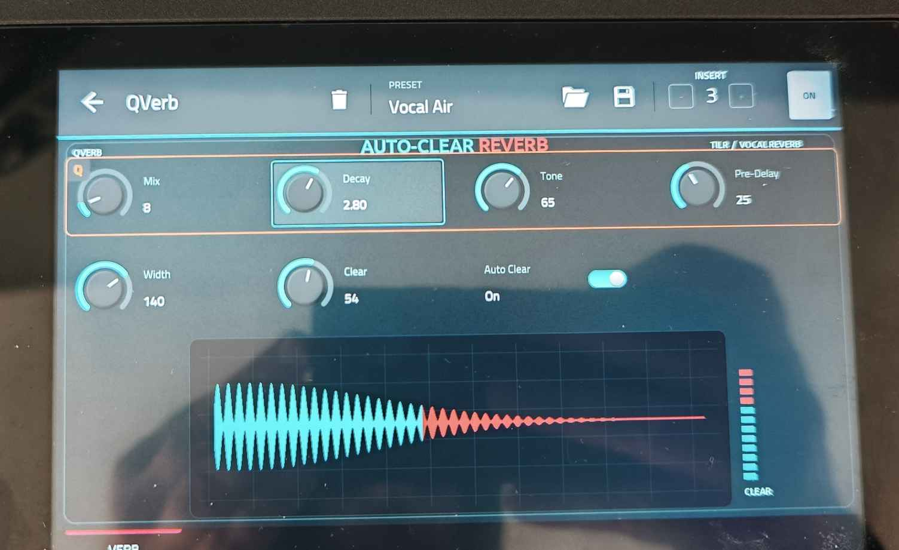

# QVerb — Auto-Clear Vocal Reverb for Akai MPC

*Technically this is [MVerb](https://github.com/martineastwood/mverb) by Martin
Eastwood plus an Auto Clear stage — see [Origin and name](#origin-and-name).*

A compact vocal reverb with six knobs and two switches. The reverb core is
Martin Eastwood's MVerb, a Dattorro figure-of-eight tank. The Auto Clear stage
is a musical vocal-keyed ducker; at 100% it becomes a hard tank clear. The
output limiter runs at 2x oversampling, so a hot reverb sum stays silky instead
of turning fizzy.



## Origin and name

QVerb did not begin as a reverb design. It began as an empty text file whose
only content was two links to DSP repositories:

- [REV-246](https://github.com/tehguitarist/REV-246)
- [MVerb](https://github.com/martineastwood/mverb)

The task was to take the **Auto Clear** feature from
[QDelay](https://github.com/coolvegan/qdelay-autoclear) and move it into a
reverb, using those two repositories as the starting points for the algorithm
choice. Both were evaluated; **MVerb was chosen as the core**. It is a complete,
compact Dattorro implementation, it stays well-behaved at long decay times, and
its parameter set (size, decay, damping, bandwidth, early/late mix) maps
directly onto the six-knob MPC UI. REV-246 served as a reference for the ducker
behaviour and the program idea; none of its EMT reverb engine is included.

In DSP terms, then, this plugin is **MVerb + Auto Clear**. The accurate name
would be *MVerb Auto Clear*. The `Q` prefix was kept only for personal
consistency with QDelay and the rest of the series — the project is the work of
someone finishing an idea for their MPC, not a new reverb algorithm. The credit
for the reverb core belongs to **Martin Eastwood**.

The two links above are also kept verbatim in [`examples`](examples).

## Controls

| Control | Function |
|---|---|
| **Mix** | dry/wet |
| **Decay** | reverb time, 0.3–12 s |
| **Tone** | dark to airy damping/bandwidth |
| **Pre-Delay** | 0–120 ms |
| **Width** | mono to extra wide |
| **Clear** | Auto Clear depth, 0–100% |
| **Auto Clear** | on/off |
| **OS 2x** | 2x oversampling around the output limiter, on by default |

No size, density, early-level or output-gain controls. The size is fixed at a
musical vocal hall and the output is limited internally.

## Output limiter and OS 2x

The final stage is a soft clipper with its knee at **−0.35 dBFS**. Below the
knee it is bit-transparent; only peaks above it are shaped. With **OS 2x** on,
the clipper runs at twice the sample rate, so the harmonics it creates stay
above Nyquist instead of folding back into the audible band. That fold-back is
what made hot tails sound harsh and "fizzy".

- **On** (default): 6 samples of latency (0.14 ms at 44.1 kHz), reported to the
  host and compensated automatically. Use this for anything loud.
- **Off**: latency-free, original 1x clipper. Useful when the track already has
  latency-critical routing or you want the exact 1.0 behaviour.

The reverb core itself is linear and static, so it does not need oversampling.

## Auto Clear for vocals

MPC effects never receive MIDI, so the trigger comes from the audio of the
voice. The detector is adaptive and works over a sustained pad or a busy mix.

- **0–99%**: the wet reverb is smoothly reduced while the vocal is present and
  blooms again after the phrase. This is the setting for breathy, airy vocals.
- **100%**: hard clear. The wet path fades to silence, the complete reverb tank
  is wiped, and the new vocal refills it. The old tail is gone.
- The dry vocal is never filtered or ducked.

## Programs

`Vocal Air` (default), `Close Vocal`, `Hazy Pad`, `Dub Vocal`, `Wide Hall`,
`Room`, `Init`, `Silky Drums`.

`Silky Drums` is Mix 7 %, Decay 2.80 s, Tone 80 %, Pre-Delay 10 ms, Width
140 %, Clear 62 %, Auto Clear on: a short, bright, wide bloom that only opens
between the hits.

## Programs and the MPC screen

Selecting a program or loading a project now updates the MPC screen right away.
The plugin reports every changed parameter to the host and requests a redraw, so
the knobs show the new values instead of the previous positions. This is the
behaviour in the 2026-11 builds.

## Build

Requirements: Docker, a C++17 compiler for the native host test, and Python 3.

```bash
./scripts/build-mpc.sh
```

The script builds the native copy, runs the MPC host simulator, generates the
touch UI, cross-compiles ARM64 and ARM32 under Docker, validates the folder and
writes:

```
dist/mpc/Tilr - VST - QVerb/
dist/Tilr - VST - QVerb-1.1.0.zip
```

Install on a connected MPC:

```bash
./scripts/install-mpc.sh
```

Copy the folder to `<drive>/VST2 Plugins/`, enable **External Plugin Support**
in the MPC preferences, restart/rescan.

## Signal path

```
Input -> 80 Hz high-pass -> Pre-Delay -> MVerb/Dattorro
      -> tone/damping -> stereo width -> Auto Clear -> dry/wet
      -> 2x oversampled limiter (knee -0.35 dBFS)
```

## Versions

- **1.1.0** — 2x oversampled output limiter with an on/off switch, knee raised
  from −0.92 to −0.35 dBFS, new `Silky Drums` program.
- **1.0.0** — first release. Tag `v1.0.0` is the reference version with the
  original 1x limiter.

## Credits and license

- **[MVerb](https://github.com/martineastwood/mverb)** by **Martin Eastwood** —
  the reverb core of this plugin (Dattorro tank). GPL-3.0-or-later. His original
  copyright header is preserved in [`src/MVerb.h`](src/MVerb.h), and the full
  licence text is in `MVERB-LICENSE.txt`.
- **[REV-246](https://github.com/tehguitarist/REV-246)** — evaluated as the
  alternative reverb algorithm and used as a reference for the ducker and the
  program idea; its EMT engine is not included in this plugin.
- MPC plugin framework from the MIT-licensed MPC Plugin SDK.
- QDelay/QVerb glue, UI and the Auto Clear port by Tilr.
- Both starting points are recorded in [`examples`](examples).

The project is GPL-3.0-or-later. See `LICENSE` and `MVERB-LICENSE.txt`.
